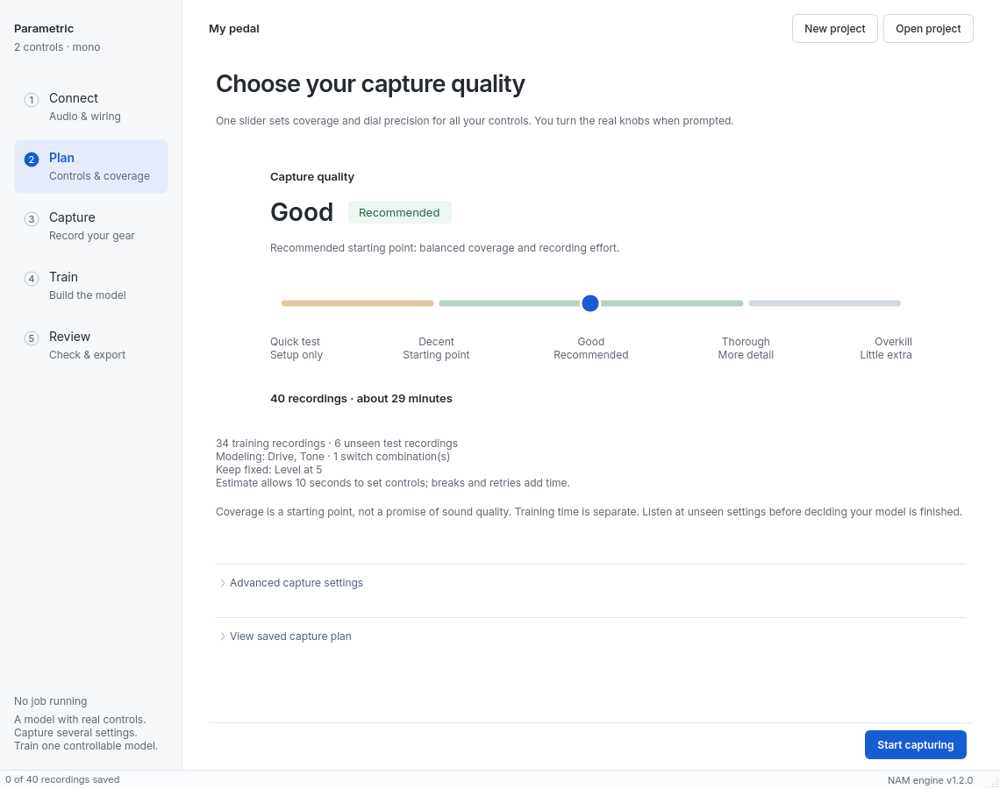

# Parametric capture for Mac

Capture pedals or amps at multiple knob and switch settings and train one controllable NAM model locally on an Apple Silicon Mac. The native app guides you through **Connect → Plan → Capture → Train → Review**, using the public [parametric NAM trainer](https://github.com/phillipmself/neural-amp-modeler-parametric) at a pinned revision.

Plan has one capture-quality slider, with **Good** recommended. The app sets recording counts and knob steps automatically, shows the actual recording effort, and keeps technical settings under Advanced. Quality means capture coverage, not guaranteed sound quality.

The desktop interface now uses the approved mockups’ bundled Inter typography, flat controls, vector routing icons, circular quality slider and physical dial diagrams. Training duration is selected with **Full training / Quick test / Custom** segments; model architecture remains a separate choice. Fonts and icons are included with the application and load locally.



## Install on an Apple Silicon Mac

You need an Apple Silicon Mac, an internet connection for installation, and native **Python 3.12** from [python.org](https://www.python.org/downloads/macos/). Python 3.11–3.13 is supported. Keep Rosetta disabled for Terminal; the installer checks for `arm64`. Python.org includes Tk, which the upstream trainer needs.

1. Download [this repository as a ZIP](https://github.com/balazsbencs/parametric-nam-trainer/archive/refs/heads/main.zip), unzip it, and move the folder somewhere permanent, such as `~/Projects/parametric-nam-trainer`. Do not run commands from inside the ZIP.
2. Open Terminal and install Apple's command line tools if needed:

   ```sh
   xcode-select --install
   ```

   Finish the installation dialog before continuing. If the tools are already installed, skip this step.
3. In Terminal, type `cd `, drag the unzipped project folder into the window, and press Return. Then run:

   ```sh
   chmod +x Install.command Capture.command Train.command
   ./Install.command
   ```

   The installer creates a local `.venv`, checks out the pinned trainer into `.upstream`, installs dependencies and downloads verified excitation signals into `inputs/`. The ML dependencies are a substantial download. Wait for **Installed. Open Capture.command to begin.**
4. Launch the app:

   ```sh
   ./Capture.command
   ```

   You can also double-click **Capture.command** in Finder after installation. **Train.command** opens the same app on Train; open your project using the header button.

If the installer selects an older system Python, specify the installed Python explicitly:

```sh
PARAMETRIC_PYTHON=/Library/Frameworks/Python.framework/Versions/3.12/bin/python3 ./Install.command
```

For a Git checkout instead of a ZIP:

```sh
git clone https://github.com/balazsbencs/parametric-nam-trainer.git
cd parametric-nam-trainer
./Install.command
./Capture.command
```

## Update an existing Git installation

Close the app, then run these commands from the project folder:

```sh
git pull
./Capture.command
```

Your capture projects live in the folders you selected and are kept separate from the application source. This update retains older continuous-knob projects; new switch projects should be opened with this companion app so their named positions are preserved.

## Your first pedal capture with a UMC22

You can explore the app before connecting hardware. **Recording needs a reamp box**, cables, your pedal and its correct power supply. Start with an overdrive, distortion or EQ pedal. Add named switch positions if you want the model to reproduce them; leave unmodeled switches fixed. Delay and modulation pedals are outside this initial capture protocol.

1. **Connect.** Name your gear and edit its controls directly: **Add knob**, **Add switch**, or **Remove**. Rename each row and click its range / position button to edit it. **Pedal starter** creates Drive + Tone; **Amp starter** creates six knobs + Bright. All starter controls are editable. Note the controls you will keep fixed, such as Level at 5. Click **New project** and choose an empty folder. The app copies the two verified excitation files automatically. Wire **OUTPUT L → reamp box → pedal input**, then **pedal output → MIC/LINE 1 using its ¼-inch jack**. Turn Direct Monitor and DAW monitoring off, disconnect speakers from capture outputs, and set the UMC22 to **48 kHz** in Audio MIDI Setup. Start levels low, check the loudest pedal setting for headroom, then keep interface and reamp levels fixed. Select the UMC22 and confirm the setup checkboxes before **Test connection**. Follow the detailed [hardware guide](docs/hardware-umc22.md), including the optional clean timing loopback.
2. **Plan.** Leave **Good** selected for a balanced start, or choose **Quick test** to check your setup with fewer recordings. The slider updates all modeled knob steps and sampling counts. Defaults assume a 0–10 dial; if your pedal uses another range, click its range button in **Connect**. Physical ranges and fixed controls remain unchanged when you move the slider. Recording time includes an allowance for turning knobs; training time is separate. Click **Start capturing**.
3. **Capture.** Turn the real knobs and switches to the displayed positions, confirm they match, then click **Record this setting**. Each accepted take is saved. The next five settings appear in the queue. The full queue and detailed QA are under **Queue and recording details**; select a row to rerecord its exact setting. After the first accepted take, quality and knob labels are locked. Use **Create a separate project** to change the plan or calibrated levels. Reopening a project requires a fresh connection test before recording.
4. **Train.** Once the plan is recorded, choose a **Model architecture** and click **Check recordings**. The default **NAM A2 · Standard + Nano (one file)** trains both sizes for Ardor. **NAM A2 Nano** uses 3 channels; **NAM A2 Standard** uses 8. **Current recipe** preserves the original automatic width. Try **Quick workflow test · 1 epoch** first, then **Full training · 200 epochs**; combined mode applies that count to each size. Automatic device selection uses the Apple GPU when available, otherwise CPU. Progress and validation metrics come from the real trainer. You can browse other stages while it runs; controls that could change its inputs are disabled. If GPU or memory errors occur, open the log and use **Retry on CPU**, which also reduces batch size to 1.
5. **Review.** Choose a saved run and inspect its status and last logged validation ESR for each trained size. That metric describes the last epoch, not a fresh evaluation of the exported checkpoint. **Save model…** copies the actual `model_parametric.nam`. In Ardor, upload it under **Assets → NAM models**, then select it in the modules drawer under **Amp and drive**. Individual concat exports can also use [NamParametricPlugin](https://github.com/phillipmself/NamParametricPlugin). FiLM exports target Ardor and Gene Ko's format; they do not use NamParametricPlugin's concat format. The stock NAM player cannot load these architectures. Compare both sizes with the saved `val_lhs_*.wav` test recordings and try unseen knob positions. Listening status is saved per run. This version has no built-in A/B audio player.

Your project folder contains `capture_project.json`, `workflow.json`, input WAVs, captures and separate `outputs/` run folders. Keep the whole folder when moving or archiving a project. Use one app window per project while recording or training. Training reads existing WAVs and saves hashes; it does not duplicate them into each run. Closing while a job runs requires stopping/cancelling and waiting first. Interrupted or failed run folders are retained; inspect them before assuming a model was exported.

## More knobs, switches and amps

Connect supports **up to 24 total controls**, with at least one continuous knob. A switch can have two or more named positions, such as Off / On or Clean / Crunch / Lead. Click its position button and enter one label per line. Capture shows those labels, and saved projects, training configs and exported models retain the switch metadata.

The quality slider adjusts the precision of every knob and allocates training and unseen test recordings to **every switch combination**. Two binary switches multiply the session by four; a three-position switch plus a binary switch multiplies it by six. The app limits a project to 32 combinations and 5,000 actual recordings and explains how to reduce an oversized plan. Keep some switches fixed or use separate projects when the effort is too high. A high-dimensional model still needs listening checks: a large knob count does not guarantee enough coverage.

With more than eight knobs, boundary captures sweep each knob at its extremes with the others near the middle, plus all-low and all-high settings. This avoids an exponential corner set. Smaller layouts keep the original gain-aware corner sampling. Test settings remain disjoint from training and boundaries.

For amp controls, choose **Amp starter** or select **Amp** and build your own layout. Start with a smaller subset and leave channel, master or presence fixed if that makes the first session manageable. This is the same capture/training engine, with an amp-specific route reminder. Actual amp hardware capture and sound quality still need verification on your equipment.

**An amp's speaker output must never connect directly to the UMC22.** A power-amp capture needs a suitable load box and its DI / line return, with impedance and power ratings appropriate to the amp. Read the [amp hardware guide](docs/hardware-amps.md) before powering up. A pedal capture needs no speaker load box.

## Troubleshooting on Mac

| Problem | What to do |
| --- | --- |
| Python version or architecture error | Install native Python 3.12; use the explicit `PARAMETRIC_PYTHON` command above. Confirm Terminal is running without Rosetta. |
| Finder will not open a `.command` file | Launch it from Terminal using `./Capture.command`. For a downloaded file blocked by macOS, use the normal Finder/Open or Privacy & Security flow if you trust the source. |
| No interface or no input | Connect the UMC22, refresh interfaces and select it in Connect. Allow microphone access for the launching app, usually Terminal or Python, in System Settings → Privacy & Security → Microphone. |
| Sample-rate warning | Set the UMC22 to 48 kHz in Audio MIDI Setup, then refresh interfaces and test again. |
| Loopback not detected | Check the optional cable and channels, or disable the optional loopback if you have not wired it. It is off by default. |
| Silence, clipping or timing QA warnings | Read recording details and the hardware guide. Correct the route; if gain calibration changes, begin a separate project rather than mixing levels. |
| GPU or memory failure | Use Retry on CPU, or reduce Batch size under Advanced training settings. The original recordings are retained. |
| Existing `.venv` or `.upstream` rejected by installer | Rename the conflicting directory and rerun. The installer preserves environments of the wrong architecture and trainer checkouts with edits. |

To inspect dependencies and the Apple GPU:

```sh
.venv/bin/parametric doctor
```

The doctor exercises an MPS convolution/backprop operation, not a complete model benchmark. macOS installation, CoreAudio recording and full MPS training still need validation on your actual Mac and pedal; development verification here used Linux and synthetic audio.

## A2 profiles and Ardor exports

New projects default to **NAM A2 · Standard + Nano (one file)**. It trains an 8-channel Standard and a 3-channel Nano independently, then writes both into **one `model_parametric.nam`**. Upload that file once in Ardor and choose **Model size → Standard / Nano**. Knobs and switches stay the same when changing size. This is an Ardor-compatible **SlimmableContainer 1.0.0** export with two complete ConcatWaveNet models, rather than a network trained with shared weights.

Individual **A2 Standard**, **A2 Nano** and **Current recipe** profiles remain available as **ConcatWaveNet 1.0.0** exports. All profiles use **48 kHz** and named controls. A2 uses the 23-layer kernel/dilation pattern, LeakyReLU activation and 16-sample head with concatenated control conditioning. The [pinned capture recipe](https://github.com/phillipmself/neural-amp-modeler-parametric/blob/a3684411076be69dab53505df14922487697f2cf/nam/capture/export.py) already uses that layer pattern; its automatic width is `8 + 2 × (control count − 1)`. The combined file requires Ardor's parametric container support; individual exports can also use NamParametricPlugin.

The architecture choice is saved with the project; existing saved choices remain unchanged. In combined mode, the selected epoch count applies **to each tier**, so 200 epochs means 200 Standard + 200 Nano. Each tier has its own checkpoint, log, export and last-epoch validation metric under `outputs/<run>/tiers/`. Review shows both metrics. The final file appears only after both training runs and packaging succeed; stopping during Nano retains the completed Standard run without publishing an incomplete combined model. Listen to both sizes at unseen settings. Raspberry Pi CPU usage still needs measurement on the device.

Exports include `metadata.gear_type` from **Connect → Gear**, so Ardor recognizes a Neural Pedal or Neural Amp, plus the project name and selected training architecture. Existing calibration and loudness metadata are preserved. Ardor supports up to 24 concat controls, including switches; preflight rejects other recording rates and larger control sets. Old exports without a gear type default to an amp in Ardor.

## FiLM training

Choose **NAM A2 FiLM · Standard + Nano (one file)** in **Train → Model architecture** to train both FiLM sizes independently. **FiLM Standard** and **FiLM Nano** export an individual size. Each selected epoch count applies to each trained size. The existing concat profiles and default choice remain available.

FiLM supports **1–16 continuous controls at 48 kHz**. Projects with named switches or more controls must use concat; preflight reports that requirement before training. The same captures, alignment, physical ranges, training/validation split, optimizer and loss settings are reused. FiLM trains a separate neural architecture, so it starts new weights. Capture plans with fixed switches can train FiLM if those switches are not modeled controls.

The local PyTorch network exports **ParametricWaveNet 0.7.0, FiLM schema 1, skip head**, matching the [Gene Ko core contract](https://github.com/mrgeneko/NeuralAmpModelerCore/blob/419bb5712e651fb7fb548f8aa54431207727aa59/NAM/wavenet/parametric_wavenet.h). It uses the A2 23-layer pattern, per-layer scale/shift before LeakyReLU, a summed skip head, and the playback core's 20 Hz DC filter. Training normalizes knob ranges internally; export folds that mapping into the learned FiLM matrices so players receive the original physical values. Target normalization is compensated in checkpoint and final exports.

The combined file is a **SlimmableContainer 0.7.0** with 3-channel Nano and 8-channel Standard children. To follow the existing FiLM player's parent-level loudness convention, packaging copies and normalizes each child's output head to −18 dB. This matches each standalone export's normalized playback. Original individual files and checkpoints remain under `tiers/`, with their original calibration. Ardor supports the individual and combined exports; verification here uses Ardor's actual C++ runtime. Gene Ko's public player uses the same format, but has not been separately exercised here.

After training, save the model from Review and upload it to Ardor once. Check both sizes on unseen audio and settings; switching sizes retains the controls. FiLM accuracy, CPU cost and training time must be compared with concat on the same real captures. Full MPS training and Raspberry Pi performance remain unverified.

## Terminal controls

```sh
.venv/bin/parametric inputs ./inputs
.venv/bin/parametric capture
.venv/bin/parametric check "/path/to/pedal project"
.venv/bin/parametric train "/path/to/pedal project" --epochs 1 --batch 4
.venv/bin/parametric train "/path/to/pedal project" --device mps --epochs 200 --batch 4
.venv/bin/parametric train "/path/to/pedal project" --device cpu --epochs 200 --batch 1
.venv/bin/parametric check "/path/to/pedal project" --architecture a2-nano
.venv/bin/parametric train "/path/to/pedal project" --architecture a2-dual --epochs 200
.venv/bin/parametric train "/path/to/pedal project" --architecture a2-standard --epochs 200
.venv/bin/parametric train "/path/to/pedal project" --architecture film-dual --epochs 200
.venv/bin/parametric train "/path/to/pedal project" --architecture film-nano --epochs 1
```

`--dry-run` performs preflight and saves run configs without training. Training rebuilds configs from the latest saved capture project. The Mac execution profile uses float32, no `torch.compile`, and no worker processes. Stop allows a graceful interrupt, with a 15-second forced-stop limit; checkpoint resuming is not exposed in this version.

`--architecture a2-dual|auto|a2-standard|a2-nano` overrides the saved profile for that command. Omit it to use the project's choice; config-only projects without a saved choice retain the current recipe. Original source configs remain unchanged. `--dry-run` in combined mode saves both tier configurations.

Preflight checks missing/mono/mismatched audio, digital full-scale peaks, silence, non-finite values, control labels, windows, capture QA and overlapping train/test settings. It does not prove converter calibration or detect every analog clipping artifact. Route QA and listening remain necessary.

## Research, design and validation

- [Parametric modeling research and source notes](docs/research.md)
- [UMC22 pedal wiring and capture instructions](docs/hardware-umc22.md)
- [Amp wiring, load boxes and control selection](docs/hardware-amps.md)
- [Verification and remaining Mac hardware checks](docs/validation.md)
- [Original UI audit](docs/ui-audit/report.md)
- [Approved workflow mockups](docs/mockups/overview.html) · [clickable prototype](docs/mockups/index.html)

The mockups use example data; the five-stage workflow is now implemented in the native Qt app. This is a source-based app, not a signed standalone Mac installer or a new plugin runtime. The original ParametricOD article does not publish its complete recipe; this tool uses the public fork's capture and training machinery.

## Development

On Linux, native imports need system Tk and PortAudio. For CPU-only validation, install a CPU PyTorch wheel before the trainer:

```sh
python3 -m venv .venv
.venv/bin/python -m pip install torch --index-url https://download.pytorch.org/whl/cpu
git clone https://github.com/phillipmself/neural-amp-modeler-parametric.git .upstream
git -C .upstream checkout a3684411076be69dab53505df14922487697f2cf
.venv/bin/python -m pip install -e '.upstream[capture-app]' -e . pytest
.venv/bin/python -m pytest
```

Editable installation is deliberate: the inspected upstream wheel package list omits its capture package. The trainer is pinned; transitive dependencies are not fully locked. Revalidate before updating either. Synthetic tests prove integration, not pedal accuracy.
