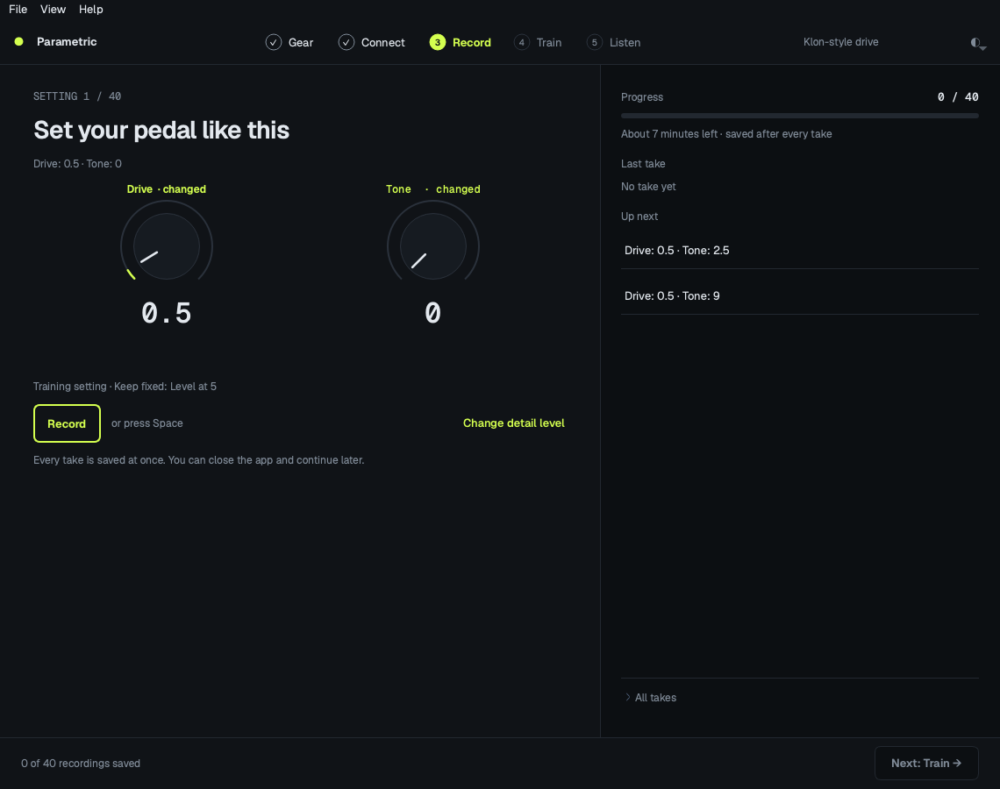

# Parametric capture for Mac

Capture pedals or amps at many knob and switch settings, and train one controllable NAM model on your Apple Silicon Mac. The app opens on **Start** and then walks you through five steps: **Gear → Connect → Record → Train → Listen**. Each step has one job and one main button. Technical settings stay under **Expert settings** on each page.

The app works with any sound card. It has a dark and a light theme: by default it follows the macOS setting, and **View → Appearance** (or the ◐ button in the top bar) lets you choose **Match macOS**, **Light** or **Dark**. Fonts (Geist and Geist Mono) and icons are bundled and load locally.



## Install on an Apple Silicon Mac

You need an Apple Silicon Mac and an internet connection for installation. The installer uses [uv](https://docs.astral.sh/uv/) to download native **Python 3.12** with Tk and create a local `.venv`. You do not need to install Python manually; your system Python can be **3.15**. Keep Rosetta disabled for Terminal; the installer checks for `arm64`.

The trainer runtime supports Python 3.11–3.13. Python 3.15 cannot run the trainer yet because PyTorch does not publish compatible wheels. `.python-version` selects 3.12 for the app independently of your system Python. If uv is missing, the installer downloads it from Astral into `~/.local/bin` without editing your shell profile. An existing uv installation is reused, including the usual Homebrew and user install locations.

1. Download [this repository as a ZIP](https://github.com/balazsbencs/parametric-nam-trainer/archive/refs/heads/main.zip), unzip it, and move the folder somewhere permanent, such as `~/Projects/parametric-nam-trainer`. Do not run commands from inside the ZIP.
2. Open Terminal and install Apple's command line tools if needed:

   ```sh
   xcode-select --install
   ```

   Finish the installation dialog before continuing. If the tools are already installed, skip this step.
3. In Terminal, type `cd `, drag the unzipped project folder into the window, and press Return. Then run:

   ```sh
   chmod +x Install.command Capture.command Train.command
   ./Install.command
   ```

   The installer creates a local `.venv` using uv-managed Python, checks out the pinned trainer into `.upstream`, installs dependencies with `uv pip` and downloads verified excitation signals into `inputs/`. The ML dependencies are a substantial download. Wait for **Installed. Open Capture.command to begin.** Existing compatible environments are reused; incompatible environments are preserved with instructions to rename them.
4. Launch the app:

   ```sh
   ./Capture.command
   ```

   You can also double-click **Capture.command** in Finder after installation. **Train.command** opens the same app; pick your project on **Start**.

To use your own native Python 3.11–3.13 with Tk instead of uv-managed Python, specify its path when creating the environment:

```sh
PARAMETRIC_PYTHON=/Library/Frameworks/Python.framework/Versions/3.12/bin/python3 ./Install.command
```

An existing `.venv` takes precedence. To change its Python, close the app, rename `.venv` to keep a backup, and rerun the installer. Unset `PARAMETRIC_PYTHON` to return to automatic Python setup. The launchers use `.venv/bin/python` directly; they do not need uv on your `PATH`.

For a Git checkout instead of a ZIP:

```sh
git clone https://github.com/balazsbencs/parametric-nam-trainer.git
cd parametric-nam-trainer
./Install.command
./Capture.command
```

## Update an existing Git installation

Close the app, then run these commands from the project folder:

```sh
git pull
./Capture.command
```

Your capture projects live in the folders you selected and are kept separate from the application source. This update retains older continuous-knob projects; new switch projects should be opened with this companion app so their named positions are preserved.

## Your first capture

You can explore the app before connecting hardware. **Recording needs a reamp box**, cables, your pedal and its correct power supply. Start with an overdrive, distortion or EQ pedal. Add named switch positions if you want the model to reproduce them; leave unmodeled switches fixed. Delay and modulation pedals are outside this initial capture protocol.

1. **Start.** Click **New capture**, or continue a project from the list. The list shows the saved state of each project, for example "Recording · 18 of 40 takes" or "Model ready".
2. **Gear.** Type a name and choose **Pedal** or **Amp**. The knobs and switches you want to turn later are tiles: click **+ Knob** or **+ Switch** to add one, × to remove one, and a name or range to change it. Pedal starts with Drive + Tone; Amp starts with six knobs + Bright. Write down the controls you keep fixed, such as "Level at 5". The drawing and the estimate ("~40 recordings · ~29 min") follow your changes. **Next: Connect** creates the project in `~/Music/Parametric/<name>`; click **Change** to choose another empty folder.
3. **Connect.** Three small stages, top to bottom:
   - **Wire it up:** sound card output → reamp box → pedal → sound card input (an amp goes through a load box; never connect a speaker output to the sound card). Turn monitoring off, unplug speakers from the sound card, and tick the checkbox.
   - **Find the connection:** pick your sound card. Click **Find my connection**. The app plays a quiet click on each output, one at a time, and listens on every input. It sets the channels for you and ignores inputs that only copy the output (a digital loopback). You can still set the channels by hand under **Expert settings**. If the sound card does not run at 48 kHz, the app says so and shows an **Open Audio MIDI Setup** button.
   - **Check the loudest level:** turn every knob on your gear to its loudest setting and click **Check level**. When the peak is good, do not touch the sound card gain again for this project.

   **Show me how to fix it** lists the common problems. The [UMC22 guide](docs/hardware-umc22.md) and the [amp guide](docs/hardware-amps.md) are two example setups, including the optional timing loopback (under **Expert settings**).
4. **Record.** Choose how detailed the capture is: **Fast** (to test your setup), **Good** (recommended) or **Max**. Each card shows the real number of takes and the time. Then set the knobs to the shown positions and click **Record** (or press Space). Controls that changed since the last take are marked "changed". After each take the app checks it: a clipped take must be recorded again, and if it clips again, start a new capture with a lower level. **All takes** lists every take, and you can record any of them again. You can change the detail level until the first take; after that, the plan is locked. A reopened project always asks you to check the level on Connect again.
5. **Train.** Choose **Quick test** (1 round, to check the workflow) or **Full training** (200 rounds per size). **Start training** first checks your recordings, then trains. While it runs you see the progress, the time left and a chart of the difference from the real pedal on the test settings. If the Mac runs out of graphics memory, click **Try again on CPU**. The model type (default **NAM A2 · Standard + Nano**, one file for Ardor), epochs, device and batch size are under **Expert settings**.
6. **Listen.** Click **Save model…** to copy the model file. Load it in Ardor (upload it under **Assets → NAM models**, then add it from the modules drawer under **Amp and drive**); single concat models also open in [NamParametricPlugin](https://github.com/phillipmself/NamParametricPlugin). The stock NAM player cannot load these models. Listen at the test settings, which were not used to train the model, and tick the two checks. **Expert settings** shows the last logged validation ESR. That number describes the last training round, not a fresh evaluation of the saved model, and the test settings also chose the best round, so listen too. **Earlier models** lists older runs. This version has no built-in A/B player.

## More knobs, switches and amps

Gear supports **up to 24 total controls**, with at least one continuous knob. A switch can have two or more named positions, such as Off / On or Clean / Crunch / Lead. Click its position text on the tile and enter one label per line. Record shows those labels, and saved projects, training configs and exported models retain the switch metadata.

The detail level (Fast, Good, Max, plus Decent and Overkill under Expert settings) adjusts the precision of every knob and allocates training and unseen test recordings to **every switch combination**. Two binary switches multiply the session by four; a three-position switch plus a binary switch multiplies it by six. The app limits a project to 32 combinations and 5,000 actual recordings and explains how to reduce an oversized plan. Keep some switches fixed or use separate projects when the effort is too high. A high-dimensional model still needs listening checks: a large knob count does not guarantee enough coverage.

With more than eight knobs, boundary captures sweep each knob at its extremes with the others near the middle, plus all-low and all-high settings. This avoids an exponential corner set. Smaller layouts keep the original gain-aware corner sampling. Test settings remain disjoint from training and boundaries.

For amp controls, select **Amp** on Gear and build your own layout from the starter. Start with a smaller subset and leave channel, master or presence fixed if that makes the first session manageable. This is the same capture/training engine, with an amp-specific route reminder. Actual amp hardware capture and sound quality still need verification on your equipment.

**An amp's speaker output must never connect directly to the sound card.** A power-amp capture needs a suitable load box and its DI / line return, with impedance and power ratings appropriate to the amp. Read the [amp hardware guide](docs/hardware-amps.md) before powering up. A pedal capture needs no speaker load box.

## Troubleshooting on Mac

| Problem | What to do |
| --- | --- |
| Python version, architecture or Tk error | Run `Install.command` with `PARAMETRIC_PYTHON` unset to use uv-managed Python 3.12 with Tk. Rename any incompatible `.venv` first. Confirm Terminal is running without Rosetta. System Python 3.15 is fine; the trainer uses its own runtime. |
| uv or Python download fails | Check your internet connection and rerun. You can also install uv with `brew install uv` or [Astral's installer](https://docs.astral.sh/uv/getting-started/installation/). |
| Finder will not open a `.command` file | Launch it from Terminal using `./Capture.command`. For a downloaded file blocked by macOS, use the normal Finder/Open or Privacy & Security flow if you trust the source. |
| Your interface is missing from the list | A split USB interface appears as one sound card (for example **USB Audio CODEC**), with its input/output counts. No Aggregate Device is needed. If two cards share a name, unplug one and press refresh. Bluetooth pairs are excluded. A missing saved card stays unselected until you reconnect it or choose another. |
| No interface or no input | Connect your sound card, press refresh (↻) on Connect and select it. Allow microphone access for the launching app, usually Terminal or Python, in System Settings → Privacy & Security → Microphone. |
| Find my connection finds nothing | Check the cables, the power of the reamp box and your gear, and that the checkbox steps are done. Then use **Choose channels myself**. |
| Sample-rate warning | Click **Open Audio MIDI Setup** on Connect, set your sound card to 48 kHz, then check the level again. |
| Loopback not detected | Check the optional cable and channels, or disable the optional loopback if you have not wired it. It is off by default. |
| Silence, clipping or timing warnings | Read the message on Record and the hardware guide. Correct the route; if the level must change, use **Start a new capture with these controls** rather than mixing levels. |
| GPU or memory failure | Click **Try again on CPU**, or reduce Batch size under Train → Expert settings. The original recordings are retained. |
| Existing `.venv` or `.upstream` rejected by installer | Rename the conflicting directory and rerun. The installer preserves incompatible environments and trainer checkouts with edits or a different revision. |

To inspect dependencies and the Apple GPU:

```sh
.venv/bin/parametric doctor
```

The installer and the doctor's MPS convolution/backprop check have passed on an Apple Silicon Mac using uv-managed Python 3.12, with system Python 3.15. The doctor is not a complete model benchmark. CoreAudio recording and full MPS training still need validation with your hardware and pedal; the training tests use synthetic audio. See the [validation record](docs/validation.md).

## A2 profiles and Ardor exports

New projects default to **NAM A2 · Standard + Nano (one file)**. It trains an 8-channel Standard and a 3-channel Nano independently, then writes both into **one `model_parametric.nam`**. Upload that file once in Ardor and choose **Model size → Standard / Nano**. Knobs and switches stay the same when changing size. This is an Ardor-compatible **SlimmableContainer 1.0.0** export with two complete ConcatWaveNet models, rather than a network trained with shared weights.

Individual **A2 Standard**, **A2 Nano** and **Current recipe** profiles remain available as **ConcatWaveNet 1.0.0** exports. All profiles use **48 kHz** and named controls. A2 uses the 23-layer kernel/dilation pattern, LeakyReLU activation and 16-sample head with concatenated control conditioning. The [pinned capture recipe](https://github.com/phillipmself/neural-amp-modeler-parametric/blob/a3684411076be69dab53505df14922487697f2cf/nam/capture/export.py) already uses that layer pattern; its automatic width is `8 + 2 × (control count − 1)`. The combined file requires Ardor's parametric container support; individual exports can also use NamParametricPlugin.

The architecture choice is saved with the project; existing saved choices remain unchanged. In combined mode, the selected epoch count applies **to each tier**, so 200 epochs means 200 Standard + 200 Nano. Each tier has its own checkpoint, log, export and last-epoch validation metric under `outputs/<run>/tiers/`. Review shows both metrics. The final file appears only after both training runs and packaging succeed; stopping during Nano retains the completed Standard run without publishing an incomplete combined model. Listen to both sizes at unseen settings. Raspberry Pi CPU usage still needs measurement on the device.

Exports include `metadata.gear_type` from **Connect → Gear**, so Ardor recognizes a Neural Pedal or Neural Amp, plus the project name and selected training architecture. Existing calibration and loudness metadata are preserved. Ardor supports up to 24 concat controls, including switches; preflight rejects other recording rates and larger control sets. Old exports without a gear type default to an amp in Ardor.

## FiLM training

Choose **NAM A2 FiLM · Standard + Nano (one file)** in **Train → Model architecture** to train both FiLM sizes independently. **FiLM Standard** and **FiLM Nano** export an individual size. Each selected epoch count applies to each trained size. The existing concat profiles and default choice remain available.

FiLM supports **1–16 continuous controls at 48 kHz**. Projects with named switches or more controls must use concat; preflight reports that requirement before training. The same captures, alignment, physical ranges, training/validation split, optimizer and loss settings are reused. FiLM trains a separate neural architecture, so it starts new weights. Capture plans with fixed switches can train FiLM if those switches are not modeled controls.

The local PyTorch network exports **ParametricWaveNet 0.7.0, FiLM schema 1, skip head**, matching the [Gene Ko core contract](https://github.com/mrgeneko/NeuralAmpModelerCore/blob/419bb5712e651fb7fb548f8aa54431207727aa59/NAM/wavenet/parametric_wavenet.h). It uses the A2 23-layer pattern, per-layer scale/shift before LeakyReLU, a summed skip head, and the playback core's 20 Hz DC filter. Training normalizes knob ranges internally; export folds that mapping into the learned FiLM matrices so players receive the original physical values. Target normalization is compensated in checkpoint and final exports.

The combined file is a **SlimmableContainer 0.7.0** with 3-channel Nano and 8-channel Standard children. To follow the existing FiLM player's parent-level loudness convention, packaging copies and normalizes each child's output head to −18 dB. This matches each standalone export's normalized playback. Original individual files and checkpoints remain under `tiers/`, with their original calibration. Ardor supports the individual and combined exports; verification here uses Ardor's actual C++ runtime. Gene Ko's public player uses the same format, but has not been separately exercised here.

After training, save the model from Listen and upload it to Ardor once. Check both sizes on unseen audio and settings; switching sizes retains the controls. FiLM accuracy, CPU cost and training time must be compared with concat on the same real captures. Full MPS training and Raspberry Pi performance remain unverified.

## Terminal controls

```sh
.venv/bin/parametric inputs ./inputs
.venv/bin/parametric capture
.venv/bin/parametric check "/path/to/pedal project"
.venv/bin/parametric train "/path/to/pedal project" --epochs 1 --batch 4
.venv/bin/parametric train "/path/to/pedal project" --device mps --epochs 200 --batch 4
.venv/bin/parametric train "/path/to/pedal project" --device cpu --epochs 200 --batch 1
.venv/bin/parametric check "/path/to/pedal project" --architecture a2-nano
.venv/bin/parametric train "/path/to/pedal project" --architecture a2-dual --epochs 200
.venv/bin/parametric train "/path/to/pedal project" --architecture a2-standard --epochs 200
.venv/bin/parametric train "/path/to/pedal project" --architecture film-dual --epochs 200
.venv/bin/parametric train "/path/to/pedal project" --architecture film-nano --epochs 1
```

`--dry-run` performs preflight and saves run configs without training. Training rebuilds configs from the latest saved capture project. The Mac execution profile uses float32, no `torch.compile`, and no worker processes. Stop allows a graceful interrupt, with a 15-second forced-stop limit; checkpoint resuming is not exposed in this version.

`--architecture a2-dual|auto|a2-standard|a2-nano` overrides the saved profile for that command. Omit it to use the project's choice; config-only projects without a saved choice retain the current recipe. Original source configs remain unchanged. `--dry-run` in combined mode saves both tier configurations.

Preflight checks missing/mono/mismatched audio, digital full-scale peaks, silence, non-finite values, control labels, windows, capture QA and overlapping train/test settings. It does not prove converter calibration or detect every analog clipping artifact. Route QA and listening remain necessary.

## Research, design and validation

- [Parametric modeling research and source notes](docs/research.md)
- [UMC22 pedal wiring and capture instructions](docs/hardware-umc22.md)
- [Amp wiring, load boxes and control selection](docs/hardware-amps.md)
- [Verification and remaining Mac hardware checks](docs/validation.md)
- [Original UI audit](docs/ui-audit/report.md)
- [Console redesign: spec](docs/superpowers/specs/2026-10-17-ux-redesign-design.md) · [approved mockups](docs/design/2026-10-17-ux-redesign/) · [screenshots](docs/screenshots/native/)
- [First design mockups (superseded)](docs/mockups/overview.html) · [clickable prototype](docs/mockups/index.html)

The mockups use example data; the Console flow (Start, Gear, Connect, Record, Train, Listen) is implemented in the native Qt app. This is a source-based app, not a signed standalone Mac installer or a new plugin runtime. The original ParametricOD article does not publish its complete recipe; this tool uses the public fork's capture and training machinery.

## Development

On Linux, native imports need system Tk and PortAudio. For CPU-only validation, install a CPU PyTorch wheel before the trainer:

```sh
python3 -m venv .venv
.venv/bin/python -m pip install torch --index-url https://download.pytorch.org/whl/cpu
git clone https://github.com/phillipmself/neural-amp-modeler-parametric.git .upstream
git -C .upstream checkout a3684411076be69dab53505df14922487697f2cf
.venv/bin/python -m pip install -e '.upstream[capture-app]' -e . pytest
.venv/bin/python -m pytest
```

Editable installation is deliberate: the inspected upstream wheel package list omits its capture package. The trainer is pinned; transitive dependencies are not fully locked. Revalidate before updating either. Synthetic tests prove integration, not pedal accuracy.
