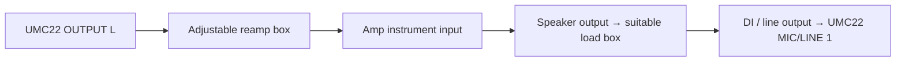

# Capturing an amp with the UMC22

The app can plan larger knob layouts and named switch positions. The amp route requires additional hardware beyond the pedal setup. Use the documentation supplied with your exact amp and load box; these instructions describe the signal path rather than certify a particular combination.

## Power-amp capture

**Never connect the amp's speaker output to the interface, reamp box or an ordinary DI input.** Before turning on a tube amp, connect its speaker output to an appropriate speaker cabinet or load box. Match the load impedance to the selected amp output, use a load with sufficient power handling, and follow its cooling and cable requirements. A reactive load box can replace the speaker and provide a low-level recording return. These requirements are described in the [Two notes Captor manual](https://wiki.two-notes.com/doku.php?id=torpedo_captor%3Atorpedo_captor_user_s_manual).

Use a speaker cable between the amp speaker output and load-box speaker input. The load's line output goes to the interface's line input with the appropriate cable; its mic-level DI output instead needs the appropriate mic connection and power arrangement. The Captor manual distinguishes its LINE and DI outputs. Follow the exact output specification of your box and leave phantom power off unless that connection explicitly requires it. [Captor connection instructions](https://wiki.two-notes.com/doku.php?id=torpedo_captor%3Atorpedo_captor_user_s_manual).

For an amp-only model, disable cabinet / speaker simulation on the recording return where the load box permits it. If you leave it on, the model captures that fixed processing as part of the chain. Keep the load setting, cabinet simulation, output level and interface gain fixed throughout a project. A mic'd cabinet is another possible recording chain, but mic position and the room then become part of the captured response.

Turn off Direct Monitor and DAW monitoring, disconnect speakers from the interface's capture sends and use 48 kHz. Start low; check the loudest modeled setting before fixing levels. Do not assume that an amp's volume setting indicates its actual output power. The load-box manual describes power and cooling limits and how quiet recording can make excessive amp output harder to notice. [Manufacturer guidance](https://wiki.two-notes.com/doku.php?id=torpedo_captor%3Atorpedo_captor_user_s_manual).

## Preamp-only capture

If your amp offers a documented line-level preamp / effects-send output, that output may provide a preamp-only return. Confirm its level in the amp manual. The speaker load requirements of the amp still apply; using a preamp return does not automatically make it safe to run a tube amp without a load. The resulting model excludes whatever circuitry is downstream of that return.

## Pick a manageable first layout

Select **Amp starter** for Gain, Bass, Mid, Treble, Presence, Master and Bright. Rename, remove or edit those controls to match the actual amp. The starter avoids zero on Gain and Master to reduce silent captures; change that setting if your hardware behaves differently.

Begin with Gain + a few tone controls and keep the rest fixed if a full layout takes too long. Add switches with named positions; the planner records every combination and allocates unseen test settings to each. Use a separate project for another channel when combining all channels would be impractical. The app handles up to 24 total controls and 32 switch combinations, with a 5,000-recording ceiling.

Physical captures, thermal behavior, CoreAudio routing and final model accuracy have not been verified on an amp in this workspace. Check the complete path with a small Quick test before committing to a long session.
