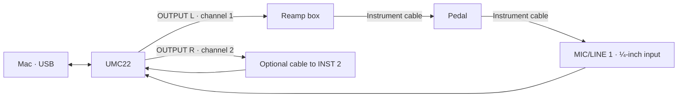

# Pedal capture with your UMC22

You can start with this interface. The first addition is a reamp box with adjustable level; a new interface is optional. The procedure below assumes a mono overdrive/distortion/EQ pedal and is a proposed route to verify on your hardware, not a measurement of your particular UMC22.

## What to get

| Item | Purpose |
| --- | --- |
| Adjustable reamp box | Feed the pedal at an appropriate instrument level and reduce grounding problems |
| Interface-output cable matching the reamp input | Connect OUTPUT L to the box; for an XLR-input box, use a correctly wired ¼-inch-to-XLR cable matching the UMC22 output |
| Two short ¼-inch TS instrument cables | Reamp → pedal; pedal → interface |
| Optional third ¼-inch TS cable | OUTPUT R → INST 2 timing reference |
| Pedal's specified power supply | Correct voltage, polarity and adequate current; isolated supply or a suitable battery can help diagnose hum |

A Radial ProRMP is one example of an adjustable, transformer-isolated passive reamper. Check that the chosen unit works with the UMC22's available output level; nominal +4 dBu boxes are not automatically optimal for every small interface. An active reamper can provide more level flexibility. Do not buy a DI box assuming it is interchangeable with a reamp box. [ProRMP product](https://www.radialeng.com/product/prormp), [manufacturer FAQ](https://www.radialeng.com/product/prormp/faq).

No amp, cabinet, microphone or speaker load box is needed to capture a pedal directly.

## Wiring

The UMC22 has a MIC/LINE 1 combo input and INST 2 input, with L/R main outputs. The instrument input is not the same as a second line input. Use the ¼-inch part of MIC/LINE 1 for the pedal return. Set both playback and recording to the UMC22 in the capture app. [Manufacturer quick-start guide](https://mediadl.musictribe.com/media/sys_master/h1f/h9b/8849476255774.pdf) (manufacturer host was unavailable during this research; verify against the guide supplied with your device).

The optional reference route uses INST 2 at low gain. A line output may overload it at some output settings: run the route test, check its peak/clipping indicators and reduce the shared OUTPUT level if necessary, then set the reamp level accordingly. If you cannot get both paths clean, disable loopback and use the capture app's return-based timing measurement, reviewing it across drive settings. A future interface with two genuine line inputs makes the reference route easier. Keep the same hardware clock for both routes.

## First connection and feedback prevention

1. Disconnect speakers from OUTPUT L/R. They are now capture sends. Close DAWs or disable all software input monitoring.
2. Turn **DIRECT MONITOR off**. Returning captured audio to a reamp send can create feedback. The headphone output shares the playback mix; it is not a spare independent capture output.
3. Start with OUTPUT, reamp level and input gains low. Leave phantom power off for this direct pedal setup. Connect the pedal's correct supply.
4. In macOS Audio MIDI Setup, select the UMC22 and use 48 kHz for input/output. Use the format the device exposes; writing a 24-bit WAV does not increase the interface's converter resolution.
5. Grant microphone permission to Terminal/Python/the app that launches capture if macOS asks. Device naming may be generic USB audio, so identify the UMC22 by unplugging and reconnecting if needed.
6. In **Connect**, select the UMC22 and click **Find my connection**. It should find Output 1 → Input 1. If the optional loopback cable is plugged in, Find shows two connections: choose **Use Output 1 → Input 1**. To set the channels by hand, open **Expert settings**: main send/return = channel 1, optional loopback send/return = channel 2. Channels in the app are numbered from one. Start with a 512-frame buffer; increase it if dropouts occur.
7. Run **Test connection** before recording training examples. Verify a clean return, a clean reference if enabled, and a detected timing signal. Software cannot turn DIRECT MONITOR off for you.

## Set levels once

Start at a clean or bypassed pedal setting. Compare a familiar dry guitar recording replayed through the reamp with the response you get from the guitar itself. Adjust reamp level to a sensible match. A sound-only comparison is approximate; a repeatable voltage measurement at the pedal input is better when you have suitable measurement equipment. The manufacturer also describes comparing replay level with the original instrument. [Reamp level procedure](https://www.radialeng.com/wp-content/uploads/2025/07/ProRMP-Manual-WEB-07-2025-1.pdf).

Then test the loudest Drive/Tone combination you expect to capture. As a practical initial target, leave return peaks around −12 to −6 dBFS. Ensure the interface itself never clips; intentional distortion inside the pedal is the behavior we want to learn. These headroom values are a starting recommendation, not a NAM requirement.

Once levels work at the loudest setting, freeze interface gains, OUTPUT level and reamp level. Photograph the controls. If you change those settings mid-session, start a separate calibrated project rather than mixing amplitude scales. Do not normalize each wet WAV individually: that erases the pedal's changing level behavior.

The UMC22's OUTPUT control affects the reference send as well. If it is changed for monitoring, the calibration changes too. For the first model, fix the pedal's Level control. If it is a simple final clean attenuator, a runtime output-gain control may be sufficient; establish that on the actual pedal rather than assuming it.

## Record the first pedal

1. Run **Install.command**, then **Capture.command**.
2. Click **New project** and choose an empty folder. The app copies the verified training and validation signals automatically.
3. Use **Add knob** / **Add switch** and name the controls you want to model. Begin with Drive and Tone; keep Level fixed. Click a knob's range button to match printed ranges, mark the gain knob, or avoid a silent zero. For a switch, enter its physical position names; every combination adds capture effort. Leave unmodeled switches at documented positions.
4. In **Plan**, leave Good selected or begin with Quick test, then click **Start capturing**. Review positions that mute the pedal; narrow the range or use avoid-zero where appropriate.
5. At each prompt, move the controls, let the pedal settle, then confirm the positions and press **Record this setting**. Review clipping, dropout and timing flags. Repeat failed takes before moving on.
6. Keep the validation section separate. The same settings must not appear in both splits.
7. Use **Train on Mac → Check captures**, then try a one-epoch run. If that succeeds, start a longer run and compare held-out audio.

For two knobs, a reasonable first trial is about 30 interior training settings, 6 validation settings, plus unique boundary points. At the published signals' roughly 38/7-second lengths, this is about 22 minutes of playback before boundaries, settling, knob changes and repeats. This is our planning estimate, not a promised session time or sufficient capture count for every pedal.

## Pedals that deserve a different plan

Traditional fuzz/wah circuits can interact with passive pickups and the guitar volume control. A low-impedance replay chain changes that interaction; the resulting model describes the chosen capture source rather than every guitar connection. Decide whether a buffered-source model is acceptable before capturing those pedals.

Time-based and modulation pedals need longer-memory models and a protocol for oscillator state, tails and time-varying behavior. Start with drive/distortion/EQ. For switches, keep one switch combination fixed per project in this first version.

If an amp becomes part of a later capture, its speaker output is a different electrical signal: it must not go into the UMC22. A valve amp needs the correctly matched cabinet or suitably rated load connected. That is a separate rig design; the present wiring is for pedals only.
